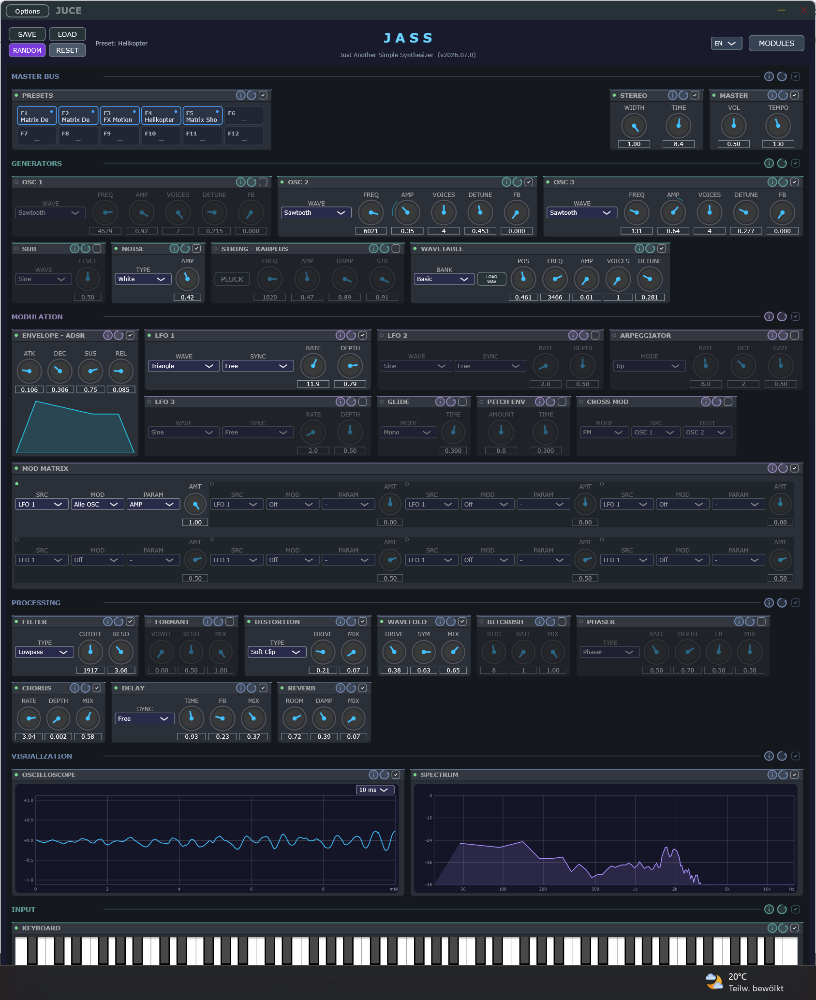
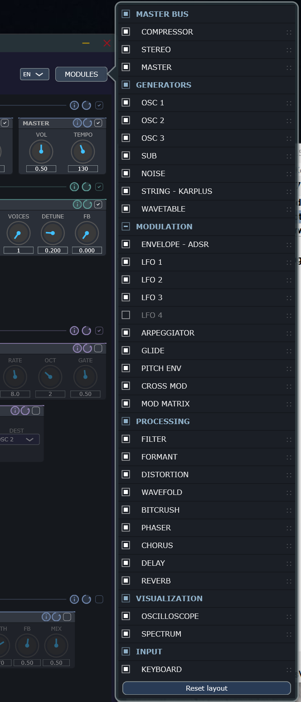

# JASS – Just Another Simple Synthesizer

A polyphonic software synthesizer with an interface styled as a **19″ rack** —
sound sources, modulation, effects, a step sequencer, drums and a bass line on
one screen. Written in **C++20 / [JUCE 9](https://juce.com/)**; runs as a
**standalone** app and as a **VST3 instrument**, on Windows and Linux.



**[⬇ Download the latest release](https://github.com/mchwalt/JASS/releases/latest)** ·
**[🎧 Hear the demo (MP3, ~1 min)](https://raw.githubusercontent.com/mchwalt/JASS/main/docs/Demo.mp3)** ·
**[JASS in a DAW](#jass-in-a-daw)**

Releases carry Windows and Linux builds (Standalone + VST3), produced by the CI
pipeline on every merge to `main`. The demo was recorded straight out of JASS;
depending on your browser it plays right away or lands in your downloads.

## Why this project

JASS is about building a **simple synthesizer with an intuitive interface** — one
where you get **quick first wins with good-sounding results** instead of getting
lost in menus. The goal is a **playful way into synthesis and sound processing**:
tweak a few knobs, hear something musical right away, and from there explore how
the pieces fit together — and invent your own solutions and signal paths, also
**off the beaten track**, beyond the usual textbook layouts.

Everything you need is on one screen: sources, modulation, and processing laid
out as a rack you can rearrange, with per-module and per-zone **enable / reset /
info** so nothing is hidden and every control explains itself.

## What makes it different

- **Write a figure by playing it.** Arm the STEP SEQ, press keys, and each one
  lands on the next step — SPACE leaves a rest. Up to 768 steps with accents,
  **TIE** and the 303's **SLIDE**; a `.mid` transcription loads as a playing
  figure and saves back out for the DAW.
- **One JASS plays a whole piece.** The patch under your hands, **PERC** drums and
  a sequenced **BASS** underneath — the two boxes run beside the patch, dry into
  the master bus, so the drums never get dragged through your filter.
- **Kunstkopf output.** Every generator is placed in 3-D by convolving it with a
  measured **MIT KEMAR** head response, and a binaural early-reflection stage
  pushes the image **out of the head** on headphones.
- **GRAIN is two instruments.** A granular cloud over any recording — and, with
  **KEY** on, a formant synth: one grain per period of the played note, so the
  sample's timbre stays put while the pitch moves.
- **A matrix that speaks the rack's language.** Pick a module, then one of its
  knobs by name. Route **CHAOS** (a Lorenz orbit) to a pitch, snap it to a scale
  with **QUANT**, and the modulation writes melodies.
- **Sample-exact in a DAW.** As a VST3 the sequencers lock to the host clock and
  hold its grid to the sample — measured headless, not just heard.
- **Presets measured off records.** Several demos are transcribed from recordings
  and checked against spectral measurements: tempo, figure, drum pattern, filter.

## Features

**Sound sources**
- **3 oscillators** — sine / sawtooth / square / triangle, each with
  **unison** (1–7 voices, detune) and **self-FM** (feedback)
- **Cross-mod / mix modes** — additive, ring modulation, FM between selectable
  sources
- **Sub oscillator** — sine/square, −1/−2 octave, tracks OSC 1
- **Wavetable oscillator** — 6 built-in banks (Basic, Digital, Harmonic, Vocal,
  PWM, Spectral), position morph, **WAV import**, own unison
- **Noise** — white / pink / brown / blue
- **Karplus-Strong** — plucked string
- **SAMPLER** — your own recordings (WAV/AIFF/FLAC/MP3, ≤60 s) through the whole
  chain: One-Shot / Loop / Reverse, SPEED 0.25×–4×, beat-locked crossfaded loops.
  **Multisampling** from a folder of `Name_C3.wav` files or a basic `.sfz`, with
  velocity layers. **STRETCH** decouples pitch from tempo (Signalsmith Stretch).
  Sets load in the background.
  - 🎹 Two multisampled grand pianos are free downloads — see
    **[Optional piano multisample sets](#optional-piano-multisample-sets)**.
- **GRAIN** — granular synthesis on the SAMPLER's set: POS/SPRAY, SIZE (5–300 ms),
  DENS, a per-grain PITCH spread that **QUANT** snaps to a scale, and **KEY** for
  the formant mode. Position, size, pitch, amp and pan are matrix targets.

**Sequencers & the two boxes**
- **STEP SEQ** — a figure of up to **768 steps** (48 per page, FOLLOW flips the
  page with the playhead), transposed by the key you play. Per step: note,
  on / accent / rest, and a gate length from staccato through **TIE** to **SLIDE**.
  The first key starts it and it keeps running; a new key moves it, SPACE stops
  it. Tempo-synced or free. **LOAD MIDI / SAVE MIDI** in the title bar.
- **PERC** — four percussion tracks on a grid of up to 768 steps with their own
  kit and a level and pan per track. Runs without a key and is the clock: a
  figure started from silence enters on the next start of the drum pattern.
  **COPY** stamps a step column, **x2** doubles the pattern. SFZ choke groups are
  honoured (a closed hi-hat silences the open one).
- **BASS** — one sequenced mono bass (saw/square, a sub an octave down, a resonant
  lowpass with its own decay envelope, glide for SLIDE steps). Flip the STEP SEQ's
  **BASS** switch and the figure plays here while the keyboard plays the patch.
- **Arpeggiator** — up / down / up-down / random. Takes the same place as the
  STEP SEQ, so only one of the two runs.

**Envelopes & modulation**
- **ADSR**, **pitch envelope**, **poly glide** (mono / legato / poly)
- **4 LFOs** — sine / triangle / square / saw / S&H / one-shot, tempo sync, rates
  down to a 200 s period, and a **GLOBAL** switch: one phase for all voices that
  no key restarts, so a filter sweep can run across a whole piece
- **CHAOS** — a Lorenz attractor as a modulation source: never repeating, never
  random. X and Y ride the same orbit, so two routings drift together but not alike
- **Modulation matrix** — **8 slots**, two-step **MODULE → PARAM** routing with a
  bipolar amount and a live modulation ring on the target knob. Sources: LFO 1–4,
  envelope, velocity, Chaos X/Y. Targets: nearly every continuous knob, a single
  oscillator or all of them at once. **QUANT** per row snaps a pitch routing to a
  scale. A routing switches on the modules it needs.

**Processing & effects**
- **Filter** (lowpass / highpass, resonance, keytracking) + **formant filter**
- **Distortion** (soft / hard clip, foldback), **wavefolding**, **bitcrusher**
- **Compressor**, **phaser / flanger**, **chorus**, **delay** (tempo sync), **reverb**
- **STEREO output stage** with a **PAN** per generator and five modes: Mono,
  **Pseudo-stereo** (Haas widener), **Stereo-Pan**, **Binaural** and
  **Kunstkopf (HRTF)**. PAN is a matrix target, so any source can move a
  generator around the head. **ROOM** adds the binaural early reflections.

**Playing & workflow**
- **On-screen keyboard** (mouse and computer keys) and **MIDI** input with velocity
- **19″ rack** with zones; every module and zone has **enable / reset / info**
  (context help in English and German)
- **MODULES** panel — show or hide modules per zone, reorder them by drag & drop,
  align them left or right within a row. The layout is saved; "Reset layout"
  restores the factory arrangement.
- **Stereo oscilloscope + spectrum analyzer**, tapped at the final output
- **Presets** in the `.jass` format plus an auto-saved live state; demo presets
  and example wavetables ship embedded and seed on first run
- **Quick-access bank F1–F12** — one press loads, a double press assigns. **F8** is
  a plain grand piano, **F9** a grain cloud, **F11** `DAF Beat`: a bass figure
  measured off a 1981 record with the record's drum pattern underneath (needs the
  free SamsSonor kit, see below).
- **Randomize** the whole rack, **reset** a module, a zone or everything



## JASS in a DAW

The same build runs as a **VST3 instrument**. In a host, JASS

- follows the **host clock** — STEP SEQ and PERC lock to tempo, song position and
  transport. PLAY starts the figure at step 1, STOP stands it still, PLAY again
  continues; a note from the track sets its root.
- exposes **one parameter per knob, grouped by module**,
- keeps its **patterns in the plugin state**, so they travel with the project,
- plays at its **standalone level**.

The rack is one patch plus two fixed boxes (PERC, BASS) by design — more voices
of music are more JASS instances on more tracks, and two instances stay in phase.

**Tested in:** Bitwig Studio 6.1, Cubase Elements 15 and Waveform Free 14
(Windows and Linux), by ear — and cross-checked headless in
[SoundCraft](https://github.com/storytold/soundcraft), a scriptable Rust host,
where the sequencer clock holds the host grid **to the sample** over four bars at
two tempi. Host-by-host record:
[`docs/notes/DAW_Candidates.md`](docs/notes/DAW_Candidates.md). #SoundCraft

## Build & run

**Prerequisites:** Visual Studio 2022 (C++ Desktop workload), CMake, Git.
JUCE is a **Git submodule** (only the commit pointer lives in this repo).

**CPU:** builds target **AVX** (`/arch:AVX`, `-mavx`), so a processor older than
Sandy Bridge / Bulldozer (both 2011) will not run JASS. That is deliberate: the
DSP is measurably ~3× faster than the SSE2 default, and AVX2 was measured to add
nothing on top, so the lower of the two equally fast baselines was chosen.

```powershell
# 1. Clone with the JUCE submodule
git clone --recurse-submodules <repo-url> JASS
cd JASS
#   (if already cloned without --recurse-submodules:)
git submodule update --init --recursive

# 2. Configure (generates build/ via CMake)
cmake -B build -G "Visual Studio 17 2022"

# 3. Build the standalone (Release)
& 'C:\Program Files\Microsoft Visual Studio\2022\Community\MSBuild\Current\Bin\MSBuild.exe' `
    build\JASS_Standalone.vcxproj /p:Configuration=Release /m
```

**Output:**
- Standalone: `build\JASS_artefacts\Release\Standalone\JASS.exe`
- VST3: `build\JASS_artefacts\Release\VST3\JASS.vst3` (target `JASS_VST3.vcxproj`)

> Note: MSBuild slash arguments (`/m`) get mangled in Git Bash — run the build
> from **PowerShell**.

### Testing

There is no automated test rig. Verification is deliberate and low-tech: it
builds, the app runs, and changes are confirmed **by eye and by ear** against
measured references (see the CHANGELOG for the reasoning per change).

The **plugin build** has one scripted check on top of that:
[`tools/rig/clocktest.py`](tools/rig/clocktest.py) drives `JASS.vst3` headless in
[SoundCraft](https://github.com/storytold/soundcraft) (fork `mchwalt/soundcraft`),
loads a sequencer figure as plugin state, bounces four bars and measures every
onset against the host's 1/16 grid — at 120 and 90 BPM, with a note entering
mid-bar, with two instances on two tracks, and with a bounce that starts off the
grid. The same rig found the two host-only bugs fixed in 2026.11.0 (a fresh
instance silent, the Init patch 6 dB hot) before any DAW session did. Recipe and
results: [`docs/notes/DAW_Candidates.md`](docs/notes/DAW_Candidates.md).

## Project layout

```
Source/
├─ PluginProcessor.*      Audio processor, APVTS, live state, app-data setup
├─ Modules/               Declarative module specs (one module = one place):
│                         <Name>Specs.h generate APVTS params + rack descriptor
├─ Audio/
│  ├─ Parameters.h        parameter IDs + applyToVoice()
│  ├─ PresetIO.h          .jass import/export, version migration
│  ├─ PatternStore.h      STEP SEQ figure + PERC grid (content, not parameters)
│  └─ SynthVoice.*        one voice (oscillators, generators, effects)
├─ DSP/                   Oscillator, Noise, KarplusStrong, WavetableBank,
│                         BiquadFilter, LFO, ADSR, Effects, ModMatrix …
└─ UI/                    rack editor + knob/display components
```

## Docs

**For developers:**

- **[`docs/ARCHITECTURE.md`](docs/ARCHITECTURE.md)** — system architecture: layers,
  audio signal flow, threading & RT-safety, state/persistence, UI architecture
- **[`docs/MODULE_SYSTEM.md`](docs/MODULE_SYSTEM.md)** — the declarative module-spec
  system ("one module = one place") + recipes for adding parameters & modules
- **[`docs/DEVELOPER_GUIDE.md`](docs/DEVELOPER_GUIDE.md)** — build, dependencies,
  versioning/CI, all configuration surfaces, compile-time tunables, build gotchas

**Reference:**

- **[`docs/JASS_Preset_Format.md`](docs/JASS_Preset_Format.md)** — the `.jass` preset format
- **[`docs/Glossary.md`](docs/Glossary.md)** — glossary (German)
- `docs/notes/` — internal ideas, research & cheat-sheet notes (not official docs)

## Versioning

JASS uses **CalVer** — `YYYY.MM.MICRO` (e.g. `2026.11.0`) — shown in the header
subtitle and the right-click title info menu. Changes land on `main` only via pull
requests, and each merge bumps the version. See **[`CHANGELOG.md`](CHANGELOG.md)**.

The app version is independent of the preset **`FormatVersion`** (an integer schema
contract — see [`docs/JASS_Preset_Format.md`](docs/JASS_Preset_Format.md)).

**Releases / CI.** A GitHub Actions pipeline (`.github/workflows/release.yml`) runs on
every merge to `main`: it derives the next CalVer, builds Windows + Linux artifacts
(Standalone + VST3), and publishes them to a GitHub release.

**Contributing.** Don't push to `main` directly — use a branch + PR. Enable the
local guard hook once per clone:

```sh
git config core.hooksPath .githooks
```

## License

JASS is released under the **[GNU AGPL v3](LICENSE)**.

JASS embeds **JUCE 9** as a submodule. JUCE is dual-licensed (**AGPLv3 or a
commercial JUCE licence**); JASS's AGPLv3 matches JUCE's free tier exactly.
Distributing JASS under other terms requires an appropriate JUCE licence.
(For a desktop instrument the AGPL behaves like the GPL — the network clause
only matters for hosted services.)

### Third-party data & code

The **Kunstkopf (HRTF)** output mode uses the **MIT KEMAR** HRTF measurements
(Bill Gardner & Keith Martin, MIT Media Lab, 1994), embedded as
[`Source/DSP/KemarHrir.h`](Source/DSP/KemarHrir.h). The data is provided free with
no restrictions on use, provided the authors are cited — see
<https://sound.media.mit.edu/resources/KEMAR.html>. The embedded header is
regenerated from the original set by [`tools/gen_kemar_hrir.py`](tools/gen_kemar_hrir.py)
(see [`tools/README.md`](tools/README.md)).

The SAMPLER's **STRETCH** mode (pitch/time decoupling) uses **Signalsmith Stretch**
by Geraint Luff / Signalsmith Audio Ltd. (MIT license), vendored under
[`Source/ThirdParty/signalsmith-stretch/`](Source/ThirdParty/signalsmith-stretch/)
together with its `signalsmith-linear` FFT dependency — see
<https://github.com/Signalsmith-Audio/signalsmith-stretch> and the license files
in that folder.

### Optional piano multisample sets

Two real grand pianos play beautifully through the SAMPLER. They are not part
of the repository (≈65 MB of samples don't belong in git history) — download
them as ready-made zips from the
[**piano-pack-v2 release**](https://github.com/mchwalt/JASS/releases/tag/piano-pack-v2)
and unzip into `%AppData%\JASS\Samples\`:

- **JASS-SplendidPiano.zip** — AKAI's Steinway recordings (samples Public
  Domain), four velocity layers (PP/MP/MF/FF), 242 regions. Ships a
  `NOTICE.txt` crediting the upstream SFZ mapping at
  [sfzinstruments/SplendidGrandPiano](https://github.com/sfzinstruments/SplendidGrandPiano).
- **JASS-SalamanderPiano.zip** — Alexander Holm's Yamaha C5
  ([sfzinstruments/SalamanderGrandPiano](https://github.com/sfzinstruments/SalamanderGrandPiano),
  **CC BY 3.0**), four velocity layers (v4/v8/v12/v16) with the natural
  stretch tuning; `ATTRIBUTION.txt` inside carries the license details and
  the change list. (Builds without velocity layers use
  [piano-pack-v1](https://github.com/mchwalt/JASS/releases/tag/piano-pack-v1).)

Picking either set in the SAMPLER auto-configures the module as an instrument
(One-Shot, no STRETCH, its own release; ENVELOPE off and Stereo-Pan output when
the sampler is the sole generator).

Both zips are reproducible from source: `python tools/build_piano_zips.py`
fetches the upstream repos (shallow) and assembles them around the curated
`.sfz` files in [`tools/piano-packs/`](tools/piano-packs/).

### Optional drum kit

The `DAF Beat` demo (F11) plays its drums through **PERC**, which needs a mapped
drum kit. It expects
[**SamsSonor**](https://github.com/sfzinstruments/SamsSonor) — Sam Greene's kit,
mapped to SFZ by kinwie, **CC BY-SA 4.0**, ~35 MB. Nothing is redistributed here:
download the repository yourself and drop it into `%AppData%\JASS\Samples\` as
its own folder, so that `SamsSonor.sfz` sits next to its `Samples/` directory.
JASS loads it straight from the upstream `.sfz` — no curated copy in between.

Any other mapped `.sfz` kit works too — Alexander Holm's
[**Salamander Drumkit**](https://archive.org/details/SalamanderDrumkit) (CC BY-SA
3.0, ~370 MB) for instance. Note that its hi-hat choke is wired around a CC64
pedal, which JASS has no equivalent for: as shipped, its closed hat silences
nothing. Adding `off_by=1` to the closed-hat groups and `group=1` to the open ones
in your copy of the `.sfz` is enough to get the usual behaviour.
