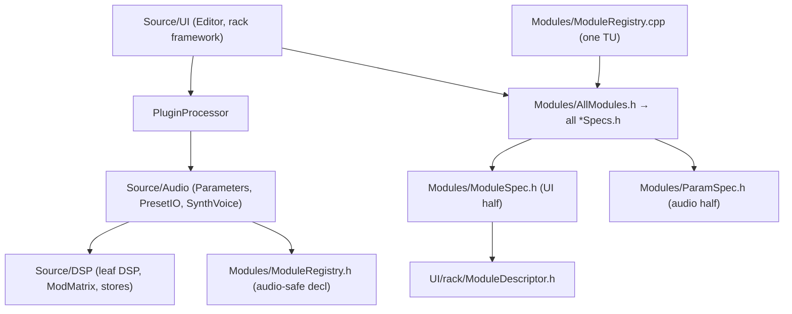

# JASS — Architecture

This document describes the system architecture of JASS: layers and dependency
rules, the audio signal flow, the threading / real-time-safety model, state &
persistence, and the UI architecture. It complements:

- [`MODULE_SYSTEM.md`](MODULE_SYSTEM.md) — the declarative module-spec system
  ("one module = one place") and the recipes for extending it
- [`DEVELOPER_GUIDE.md`](DEVELOPER_GUIDE.md) — build, dependencies, versioning,
  configuration surfaces, known gotchas
- [`JASS_Preset_Format.md`](JASS_Preset_Format.md) — the `.jass` preset format
- [`Glossary.md`](Glossary.md) — abbreviations & domain terms (APVTS, HRTF,
  CalVer, …); special terms below link to their glossary entries

The formal design record (architecture decisions **AD-1…AD-12**, PRD, epics,
per-story implementation notes) lives in `_bmad-output/` — see
[§9](#9-design-decision-record).

> Conventions in this doc: code references name **files and symbols**, not line
> numbers. All paths are relative to the repo root.

---

## 1. Overview

JASS is a polyphonic software synthesizer written in **C++20** on
**[JUCE 9](Glossary.md#juce)** (vendored as a Git
[submodule](Glossary.md#submodule)). It builds as a
**[Standalone](Glossary.md#standalone)** app (primary target) and a
**[VST3](Glossary.md#vst3)** plugin (validated in a DAW host 2026-10-05, Story 3.4;
see AD-13) from a single CMake project.

Key characteristics:

- **8 [voices](Glossary.md#voice)**, each carrying its own complete generator + effect chain
  (instantiated per output channel — see [§4](#4-audio-signal-flow)).
- **Declarative module system**: a synth module (FILTER, LFO, SAMPLER, …) is
  declared once in a spec header; APVTS parameters, the rack UI descriptor and
  the nested preset persistence are all *generated* from that spec.
- **19″-rack UI**: one generic `ModuleFrame` renders every module from data
  (`ModuleDescriptor`); a grid engine (`Rack`) owns all placement.
- **`juce::AudioProcessorValueTreeState` ([APVTS](Glossary.md#apvts)) is the
  single source of truth** for all parameter state. Cross-module coupling
  happens only through APVTS ([AD](Glossary.md#ad)-9) — no module holds a
  reference to another.
- **[Append-only](Glossary.md#append-only) compatibility contract**: parameter IDs, choice orders, enum
  indices and preset fields are never renamed, reordered or removed. New things
  are appended; missing fields load as factory defaults.

---

## 2. Layer model

```
Source/
├─ PluginProcessor.{h,cpp}   Plugin core: SynthyProcessor (AudioProcessor, Timer,
│                            ValueTree::Listener, APVTS::Listener, MidiKeyboardState::Listener)
├─ Audio/
│  ├─ Parameters.h           Param ID namespace + createLayout() + applyToVoice()
│  ├─ PresetIO.h             .jass persistence, AppData folders, seeding, migrations
│  ├─ SynthVoice.{h,cpp}     One voice: generators + per-channel effect chain
│  └─ SynthSound.{h,cpp}     Trivial SynthesiserSound (applies to all notes/channels)
├─ DSP/                      Leaf DSP classes (mostly header-only), ModMatrix,
│                            ModTargets/ModMatrixCatalog, spatial panners, stores
├─ Modules/                  Declarative module specs (see MODULE_SYSTEM.md)
└─ UI/                       Editor, displays, help system
   └─ rack/                  Generic rack framework: Rack, ModuleFrame,
                             ModuleDescriptor, SynthyLookAndFeel, IconButton
```

### 2.1 Dependency direction



Dependencies point **downward only**: UI → core → audio → DSP, never back up.
The rules that keep this true:

- **`Modules/ParamSpec.h` is the audio-safe half** of the spec model — it has
  no UI includes, so `Parameters.h` stays UI-free.
- **`Modules/ModuleSpec.h` is the UI half** — the only spec header that pulls
  in `UI/rack/ModuleDescriptor.h`.
- **`Modules/ModuleRegistry.h`** exposes audio-safe declarations only
  (`createParameterLayout`, `writeState`, `readState`). Its definition in
  `ModuleRegistry.cpp` is the *single* translation unit that includes
  `AllModules.h` (and therefore the UI headers). `Parameters.h` and
  `PresetIO.h` include only the registry header.
- **`DSP/ModTargets.h`** and **`DSP/ModMatrixCatalog.h`** are deliberately
  dependency-free (no JUCE) so the audio, UI and persistence layers can share
  one target vocabulary. `rack::ModTarget` is a type alias for `LFOTarget`.
- `PluginProcessor.h` includes Audio/ + DSP/ only; the editor include lives in
  `PluginProcessor.cpp`.

### 2.2 What is generated vs. hand-written

| Generated from module specs | Hand-written |
|---|---|
| APVTS parameter layout (`createLayout()` is one call: `Modules::createParameterLayout`, one parameter group per module) | DSP `process()` of every module (`Source/DSP/`) |
| Rack UI descriptors (`makeModuleDescriptor`) | Param → DSP wiring (`Parameters::applyToVoice`) |
| Nested `.jass` persistence (`Modules::writeState/readState`) | ~9 modules with editor-bound UI bodies (see MODULE_SYSTEM.md §6) |

---

## 3. Threading & real-time-safety model

Two threads matter: the **[audio thread](Glossary.md#audio-thread)** (all of
[`processBlock`](Glossary.md#processblock) and everything it calls, including
`applyToVoice` and `SynthVoice::renderNextBlock`) and the **message thread**
(UI, timers, preset load/save). Rules, all enforced in code
([RT-safety](Glossary.md#rt)):

### 3.1 No allocation / locking / logging on the audio thread

- **Parameter reads** use cached raw atomics — `*apvts.getRawParameterValue(id)`.
- **Indexed parameter IDs** (`oscOn(i)`, `lfoRate(i)`, `modSlotSource(n)`, …)
  would each construct a `juce::String` per call (~550 heap allocations per
  block before the fix). The `JASS_INDEXED_ID` macro in `Parameters.h` replaces
  them with references into `static std::array<juce::String, N>` caches;
  `warmIndexedIds()` (called from `prepareToPlay`) pre-builds every cache on
  the message thread so no static-init guard lock can fire on the audio thread.
- **MIDI/scratch buffers are members**, pre-sized in `prepareToPlay`
  (`arpKeptScratch`, `glideRebuiltScratch`, glide note vectors with
  `reserve(128)`), and reused every block.
- **All channel strips of every voice are prepared up-front** in
  `SynthVoice::prepareToPlay`, so switching to a stereo output mode later never
  allocates.
- **Store contract (never-free)**: `WavetableBankStore` (`MaxBanks = 64`) and
  `SampleBankStore` (`MaxSets = 32`) are append-only slot arrays with an
  atomic `count` (release/acquire). A voice caches a raw
  `WavetableBank*`/`SampleSet*` (and since Story 12.2 a `SampleZone*` picked at
  note-on) for a whole render block or longer, so entries are **never freed** —
  "reset" merely lowers `count` (deferred reclamation). The sample store is
  bounded by three caps (60 s per file, 3600 s per set, 4 GiB global byte
  budget — raised in Story 12.5 for velocity-layered pianos), so never-free
  stays a bounded policy, not a leak.
- **Sample loading is off the message thread** (Story 12.6): a background
  thread in the processor scans the Samples folder, and a preset asks for the
  set it needs by NAME through `PresetIO::requestSamplerSet` instead of
  decoding it inline — the loader pulls that set to the front of its queue and
  selects it when it lands. `SampleBankStore::writerLock` serialises only
  `append()`, **never a decode**: holding it across a set would block the
  message thread for as long as a grand piano takes to decode. The audio
  thread's read path is untouched (`count`/`sets` via release/acquire).
  `pendingSamplerSetName` keeps the 1.5 s LiveState autosave from persisting
  the name behind an index that has not been resolved yet.
- Spatial DSP (`HrtfPanner`, `BinauralRoom`) is fully static-sized.

### 3.2 `parameterChanged` deferral

APVTS calls `AudioProcessorValueTreeState::Listener::parameterChanged`
*synchronously on the changing thread* — under host automation that is the
audio thread. `SynthyProcessor::parameterChanged` therefore does **no work**
off the message thread: it only sets atomic dirty flags
(`matrixEnablesDirty`, `crossModDirty`, `pendingCrossModCode` — the latter
encodes the parameter as a small int precisely to avoid constructing a
`juce::String`). The editor's 30 Hz timer drains them via
`reconcileParamCouplingsIfDirty()`, which runs the auto-enable couplings
([§5.4](#54-auto-enable-coupling)) on the message thread.

### 3.3 UI ↔ audio handoff (atomics inventory)

| Atomic | Purpose |
|---|---|
| `WaveformCapture::writePos` | scope ring index; audio writes release, GUI reads acquire |
| `lfoDisplayValues[kNumLFOs]` | last uiLFO values → mod rings + global mod path |
| `currentNoteRatio`, `heldNotesLo/Hi` | played-note ratio for the FREQ knob display |
| `pluckRequested` | PLUCK button → `exchange(false)` on the audio thread |
| `autoPlayEnabled`, `liveDirty`, `fixingMixSrc`, `matrixEnablesDirty`, `crossModDirty`, `pendingCrossModCode` | flags described above |

### 3.4 Timers

| Timer | Rate | Job |
|---|---|---|
| `SynthyProcessor` (Standalone only) | 1.5 s debounce | LiveState auto-save when `liveDirty` |
| `SynthyEditor` | 30 Hz | mod rings, FREQ displays, zone-header sync, coupling drain, F-key poll, keyboard enable gate |
| `ModuleFrame` | 20 Hz (only if the module has dynamic state) | dim state, conditional knobs, combo dependencies, slot LEDs |
| Displays (`WaveformDisplay`, `SpectrumDisplay`, `SpinningTitle3D`) | 30 Hz | repaint |
| `EnvelopeDisplay` | 20 Hz | ADSR curve |

### 3.5 Keyboard focus model

The on-screen keyboard is the **only** focusable component: after `buildRack()`
a recursive walk clears `wantsKeyboardFocus` on every other child, and the
editor itself refuses focus. Computer-key playing therefore works regardless of
which control was clicked last. Global shortcuts must not rely on focus:
they are event-driven via `keyStateChanged`/bubbling (F1–F12 preset bank,
arrow-key octave switch, Space = PLUCK), with a polled physical-key fallback
for the F-keys while a modal call-out or combo popup owns the focus (guarded by
`juce::Process::isForegroundProcess()`).

---

## 4. Audio signal flow

### 4.1 Voice management

- `SynthyProcessor` owns a `juce::Synthesiser` with **8 × `SynthVoice`** and one
  `SynthSound` (applies to all notes/channels).
- **Pitch model**: all FREQ knobs describe the sound at **C4 (MIDI 60)**; the
  played note transposes every generator via
  `transposeRatio = f(note)/f(60)`.
- **[Auto-play drone](Glossary.md#drone)**: while any generator is enabled and no key is held, a
  drone note (C4) plays on **MIDI channel 16** (`kDroneChannel`) so it never
  collides with played notes (channel 1). The first real key press silences it;
  a rising generator-enable edge re-arms it. The drone deliberately does not
  pluck the Karplus string.
- The **[arpeggiator](Glossary.md#arp)** works by *MIDI rewriting* in `processBlock`: raw channel-1
  note on/offs are filtered out of the block's MIDI buffer and replaced by the
  arp's sample-accurate step sequence (the drone on channel 16 passes through).
- **[Glide](Glossary.md#glide)** runs on the **final** MIDI buffer (after the arp) so it also glides
  arp steps. Poly mode maps new chord notes onto the previous chord
  position-wise (pitch-sorted); Mono/Legato mode rebuilds the buffer with
  explicit note-offs for the previously sounding note. Voices consume the
  shared `GlideInfo` in `startNote` via a multiplicative `SmoothedValue`.
- **[ADSR](Glossary.md#adsr)-off behaviour**: when the ADSR module is disabled, a 10 ms
  `SmoothedValue` gate (`bypassGate`) replaces the envelope both as gain and as
  the voice-free trigger — no clicks, no stuck voices.

### 4.2 Per-voice rendering (`SynthVoice::renderNextBlock`)

Per block: capture the "base" value of every modulatable parameter, derive the
active mod-slot masks, compute the channel count and per-generator pan gains,
and (in Kunstkopf mode) select each generator's HRIR kernel **once per block**
(refreshed every 64 samples only while PAN is actively modulated).

Per sample:

1. Advance glide, all LFOs (each exactly once), the ADSR (once — reused as
   both gain and mod source; the envelope *source* is zero when the ADSR
   module is off), and the bypass gate.
2. `modMatrixAccumulate(...)` — sum all active slots into a per-target offset
   array plus per-OSC offsets. Pure accumulation; curves/clamps are applied
   per target afterwards.
3. **Pitch**: global `Frequency` offset (octaves) + per-OSC pitch offsets,
   clamped to ±4 octaves (`kMaxPitchOct`); the pitch envelope multiplies
   osc + wavetable + sub (not Karplus — its string length is fixed at pluck
   time).
4. Apply generator-target mods (wavetable pos/amp/…, sub/noise/sampler level,
   Karplus amp/damp/stretch, per-OSC detune/feedback/voices/amp).
5. **Mix the generators into the per-channel bus via equal-power panning**
   (`addPanned`), in this order: [cross-mod](Glossary.md#crossmod) branch
   (FM: OSC A modulates OSC B's phase, only the carrier is emitted; RingMod:
   `a·b·2`; otherwise all three OSCs additive) → noise →
   [Karplus](Glossary.md#karplus) → [wavetable](Glossary.md#wavetable) → sub →
   [sampler](Glossary.md#sampler) (stereo sample sets render as two placed
   sub-sources `PanSamplerL/R`; a multisample set's zone — key range + own
   root — is picked per voice at note-on, Story 12.2; the optional STRETCH
   mode decouples pitch from time via a per-voice vendored Signalsmith
   Stretch instance — configured in `prepareToPlay`, allocation-free in
   `process` — Story 12.3) → **GRAIN** (`DSP/GrainEngine.h`, Story 17.1: a
   per-voice pool of 32 Hann grains on the zone the sampler picked at note-on,
   own pan pair `PanGrainL/R`; grains per second scheduling, pool-full drops
   the new grain, per-grain pitch drawn uniformly over `ScaleMask.h` degrees;
   scheduling runs through the release — the voice ADSR shapes the cloud.
   KEY, Story 17.2: the grain rate is the played note's frequency and the
   content is not transposed — pitch-synchronous granular / FOF, the sample's
   formants stay put; the rate follows the glided ratio per sample like the
   oscillators do).
6. Global amplitude tremolo, then the envelope/gate gain.
7. **Per-channel effect chain** — each output channel owns a full
   `ChannelStrip`, so a left-panned generator also reverberates left:

   ```
   applyFxMods → wavefolder → ×ampGain → filter → formant → ×envGain
   → distortion → bitcrusher → phaser → chorus → delay → reverb → clamp(±1)
   ```

**[`DSP/ChannelStrip.h`](Glossary.md#channelstrip)** is the channel-agnostic voice bus:
`kMaxOutChannels = 2` (a later surround phase raises it),
`kNumPanGenerators = 11` (OSC 1–3, SUB, NOISE, KARPLUS, WAVETABLE, SAMPLER L/R, GRAIN L/R),
`positionToGains()` returns 1.0 for mono (byte-identical legacy path) or
equal-power cos/sin for stereo. The voice's legacy single-channel FX members
are reference aliases onto `strips[0]`, so all pre-stereo code paths still
compile against channel 0. Delay and reverb are **per voice**, not bus sends.

### 4.3 Bus processing (`SynthyProcessor::processBlock`)

Stage order after the housekeeping (auto-play/drone, tempo resolve from host
BPM or the MASTER TEMPO knob, arp MIDI rewrite, glide):

1. `synth.renderNextBlock(...)` — all voices mix into the buffer. Then the two
   **boxes** (AD-15) render dry into the same buffer: `perc.processBlock` (the
   drums) and `bass.processBlock` (the sequenced bass, fed by the STEP SEQ's MIDI
   when its BASS switch is on). Neither passes through a voice or its effects.
2. Advance the four `uiLfos` → `lfoDisplayValues[]` (these feed the mod rings
   and the global mod path — "ring == audio"). Since Story 20.1 a `uiLfos[i]`
   is also THE instance of LFO i when its GLOBAL latch is on: every voice reads
   its value (handed over before step 1, so one block behind, and ramped across
   the block inside the voice) instead of its own per-voice LFO.
3. **Compressor** (feed-forward, stereo-linked peak detector) on the summed mix.
4. **StereoWidth** (Lauridsen complementary comb, mono-compatible) — only in
   **Pseudo-Stereo** mode.
5. **BinauralRoom** (ROOM early reflections) — only in **Kunstkopf** mode,
   reset on mode entry.
6. **Master volume** via `applyGainRamp` (zipper-free under modulation).
7. **WaveformCapture tap — the very last stage**: the oscilloscope and
   spectrum show the true final output, after everything including master
   volume.

### 4.4 Spatialization (STEREO output stage)

[`OutputMode`](Glossary.md#outputmode) (must match the STEREO module's choice
order): `Mono = 0`, `PseudoStereo = 1` *(default)*, `StereoPan = 2`,
`Binaural = 3`, `Kunstkopf = 4`.

- **Mono / [Pseudo-Stereo](Glossary.md#pseudo-stereo)** reproduce the historic
  engine byte-identically (voices render one channel; the Haas widener runs on
  the bus).
- **Stereo-Pan**: true amplitude panning per generator (equal-power).
- **[Binaural](Glossary.md#binaural)** (`DSP/BinauralPanner.h`): parametric
  headphone 3-D per generator per voice — fractional-delay
  [ITD](Glossary.md#itd) (≤ 0.9 ms), [ILD](Glossary.md#ild) (far ear
  ≈ −16 dB), 700 Hz head-shadow lowpass, 1 ms slew.
- **[Kunstkopf (HRTF)](Glossary.md#kunstkopf)** (`DSP/HrtfPanner.h`): real
  out-of-head placement by convolving each generator with a measured
  **[MIT KEMAR](Glossary.md#kemar)** head impulse response
  ([HRIR](Glossary.md#hrir), 128 taps, 19 azimuths × 5°, embedded in
  `DSP/KemarHrir.h`; static-sized, two dot products per sample, kernel chosen
  once per block).
- **[ROOM](Glossary.md#room)** (`DSP/BinauralRoom.h`): a shared binaural early-reflection stage on
  the bus (6 non-harmonic prime-delay taps, 8–24 ms, rendered through lateral
  KEMAR ears) that externalizes the headphone image. The knob is a 5-detent
  macro (wet −3…+6 dB × damping 5→10 kHz), level-neutral via per-detent
  measured constants; the **centre detent is the ear-tested optimum**.

Both per-voice spatial renderers exist as one instance **per generator per
voice** (`binaural[kNumPanGenerators]`, `hrtf[kNumPanGenerators]`).

---

## 5. Modulation architecture

### 5.1 Sources, slots, targets

- **Sources** (`DSP/ModMatrix.h`, append-only):
  `ModSource { LFO1, Envelope, Velocity, LFO2, LFO3, LFO4 }` — `kNumSources = 6`.
  The envelope source is gated by the ADSR module enable;
  [velocity](Glossary.md#velocity) is captured in `startNote`.
  [LFOs](Glossary.md#lfo) have **no built-in target** anymore — they modulate
  exclusively through [matrix](Glossary.md#modmatrix) slots (`kNumLFOs = 4`,
  `DSP/LFO.h`).
- **Slots**: `ModMatrixConfig::kNumSlots = 8`. A slot is
  `{source, target, oscIndex, amount}` (bipolar amount); slots **stack** —
  multiple sources on one target sum.
- **Targets**: the X-macro table `JASS_MOD_TARGETS` in `DSP/ModTargets.h` is
  the single flat vocabulary (~59 entries) generating the
  [`LFOTarget`](Glossary.md#lfotarget) enum, persist names, labels and
  enable-param IDs. **Append-only** — indices are persisted in presets and
  [DAW](Glossary.md#daw) state.
- **Catalog**: `DSP/ModMatrixCatalog.h` (`ModDest`) provides the two-step UI
  vocabulary **MODULE → PARAM** (max 6 params per module, `kMaxParams`).
  Per-OSC modules carry `oscIndex 0..2` (only that oscillator moves); "Alle
  OSC" carries `-1` (classic global behaviour).

### 5.2 Per-voice application

`applyToVoice` resolves each slot's `(module, param)` to an `LFOTarget` +
`oscIndex` per block; the voice accumulates per sample
(`modMatrixAccumulate`) and applies each active target **once** with its own
scale + clamp — generator targets on the shared generators, FX targets per
channel strip. A guard mask (`tActive[]`) guarantees the default state is
byte-identical: inactive targets are never touched.

### 5.3 Global (block-rate) application

STEREO / MASTER / COMPRESSOR run on the summed bus, so their routings cannot
be applied per voice. `processBlock` accumulates them into a `gMod[]` array
from the previous block's `lfoDisplayValues` (one-block latency, deliberately
matching the ring feed). **Only LFO sources** drive global targets — velocity
and envelope have no single global value. Consumers: master volume (ramped),
master tempo (±90 BPM), compressor parameters, stereo width/time.

### 5.4 Auto-enable coupling

An active slot auto-enables its **source module** (LFO n / ADSR) and its
**target module** (via `ModDest::enableIdOf`). The `matrixAutoEnabled` map
records which modules *we* switched on, so auto-disable never turns off
something the user enabled manually. The CROSS MOD sibling
(`syncCrossModEnables`) keeps both operand OSCs on while cross-mod is active
and switches CROSS MOD off when a used operand OSC is disabled. Both run on
the message thread only (see [§3.2](#32-parameterchanged-deferral)).

### 5.5 Live [mod rings](Glossary.md#mod-ring)

`rack::LiveModFeed` carries one value per target (`byTarget[kCount]`) plus a
per-OSC matrix (`osc[3][kOscRingSlots]`). The editor's 30 Hz timer builds the
feed from `lfoDisplayValues` (only LFO sources animate — Env/Vel need a
sounding note) and fans it out through `Rack::updateLiveFeed` →
`ModuleFrame::updateLiveFeed` → `SynthySlider::setModAmount`. Per-OSC routings
light only the targeted oscillator's knob.

---

## 6. State & persistence

**APVTS is the hub.** Everything else hangs off it:

- **[LiveState](Glossary.md#livestate) (Standalone only)**: the processor is a `ValueTree::Listener`;
  any change sets `liveDirty`, a 1.5 s timer debounces
  `PresetIO::saveToFile(liveStateFile())`. On startup:
  `migrateLegacyAppData()` → seeding → `convertOldPresets` → LiveState load →
  an async re-load so LiveState wins over the JUCE standalone wrapper's own
  restored state (`JASS.settings`). In a plugin host all of this is skipped —
  the host owns project state.
- **"Current State" detection** is a value-compare against a snapshot
  (`markPresetClean` / `isPresetModified`), deliberately **not** a change
  listener (APVTS tree callbacks are asynchronous and would race the
  clear-after-load).
- **[Rack layout](Glossary.md#racklayout)** is one JSON string property `"rackLayout"` on `apvts.state`
  (written only when non-default) — so `getStateInformation` carries it in the
  DAW state for free, and `PresetIO` mirrors it into the preset as a nested
  `"RackLayout"` field.
- **VST3 state**: `getStateInformation` = `copyState → XML → binary`;
  `setStateInformation` first runs the idempotent XML migration for pre-v5
  matrix parameters, then `replaceState` + `markPresetClean`.
- **VST3 parameter view** (2026-10-10): one unit per rack module
  (`AudioProcessorParameterGroup`, id = module id, name = module title), the
  units ordered by rack zone and then title (`Modules::createParameterLayout`;
  the specs' registration order in `all()` is unaffected — and since Cubase
  orders units by their numeric id, which JUCE hashes from the group id, each
  group id carries a `#<n>` suffix chosen so the hashes ascend in that order);
  parameter names are `"<title> <hostName|uiLabel|persistKey>"`; the internal
  LFO `Target` is registered **not automatable**. The sequencer patterns are no
  parameters at all since 18.5 (AD-14): the STEP SEQ figure and the PERC grid
  live in `PatternStore` and ride in the DAW state as one `<StepPattern>` /
  `<PercPattern>` element each; `setStateInformation` folds a pre-18.5
  project's cell parameters into the store once. A host sees ~150 parameters. VST3 parameter ids are hashes of the APVTS ids and
  unchanged, so edits saved with earlier builds keep loading. Whether a host
  hides non-automatable parameters or shows units as folders is the host's
  call (Cubase does both; Bitwig flattens the list).
- **Preset format**: nested JSON per module,
  [`PresetIO::kFormatVersion = 10`](Glossary.md#formatversion),
  load = *factory-reset everything first, then layer the file on top* —
  missing fields land on factory defaults. [Migration](Glossary.md#migration) chain v<3 (flat) → v3
  (nested) → v4 (LFO target folded into slots) → v5 (DEST split
  MODULE + PARAM) → v6 (catalog A→Z param remap), with backups to
  `%AppData%\JASS\PresetsBackup`; v7–v10 changed the *spelling* of the
  step, lane and slot arrays and write every field, and need no value
  migration. Details: [`JASS_Preset_Format.md`](JASS_Preset_Format.md).

Side channels the module specs deliberately do not cover: `RackLayout`
(above), `Sampler.File` (sample set referenced **by name**, re-resolved on
load — since Story 12.2 the name may also resolve to a multisample subfolder
`Samples\<SetName>\`; since 12.6 the resolution is handed to the background
loader instead of decoding inline), and `PresetBanks.json` (F1–F12
assignments — a global app setting, not part of any preset).

One preset-authoring trap worth naming: picking a mapped set BY HAND in the
SET combo runs `oneShotForMappedSet`, which sets MODE, STRETCH, ENVELOPE,
output mode and — if REL is still 0 — a release time. **A preset load
deliberately does not run it**, so a sampler preset must carry `Release`
itself where its `.sfz` does not supply `ampeg_release` on every region
(Splendid has it on its six lowest regions per layer only; Salamander on all
of them). Without it the notes cut off at note-off.

---

## 7. UI architecture

### 7.1 Editor & rack

`SynthyEditor` = header band (SAVE/LOAD/RANDOM/RESET, preset name, spinning
3-D title, language combo, MODULES button) + the `rack::Rack` body. Fixed
design width **1920 px** (`kDesignW`); the height auto-fits the visible rack
(`refitHeight()`), with a display-fit down-scale transform on small screens
(AD-12).

That scale comes from the worst case — `Rack::maxHeight()` — but since Story
7.3 the worst case is every module that **may appear** (visible now, or
visible in the descriptor defaults), not every module that exists. Revealing
a module (a preset enabling one) only ever *adds* to the visible set, so
preset switching still cannot make the window jump, which is what the
measure-the-worst-case rule was introduced for; but hiding a module now gives
its height *back*, which the old "count everything" rule never did.

The floor is **derived, not a constant**: `1.0 / display->scale`, i.e. never
render smaller than 1:1 in physical pixels. On a desktop at 150 % that is
0.667 — measured as exactly the point where the rack stops being readable.

Rack height is a **budget**, not something the scale can keep absorbing: it
already sits at that floor. The MODULES panel therefore shows what the
current selection costs (`Rack 1608 / 1929 px · scale 0.79`) so revealing a
module is a visible trade rather than type that silently shrinks.

The **[Rack](Glossary.md#rack)** owns all placement (AD-2): a proportional
**30-column** grid (`kDefaultCols`) × rack-unit rows (`kHu = 114 px`). The
grid went 24 → 30 with Story 7.3, hand in hand with the design width
1520 → 1920: that keeps a column at ~53 px, so **no module changed physical
size** — size classes are absolute column counts — while six more columns per
row pack the rack two rows shorter (measured: 1980 → 1608 px, scale 0.65 →
0.79). Height was the scarce dimension; width was idle. Only the full-width
modules had to follow, `W24 → W30` (MOD MATRIX, KEYBOARD).
[Zones](Glossary.md#zone) (append-only enum, persisted by name):
`Generators, Modulation, Processing, Visualization,
MasterBus, Input`. Zone headers are *derived* — a zone renders iff it has a
visible module — and carry enable (group bypass "with memory"), reset and info
controls. The layout model (`RackLayoutEntry {id, zone, position, visible,
alignRight}`) is the single source of placement truth; `layout(width, apply)`
is the one packing path, also used for `preferredHeight()`.

Two invariants keep audio and visibility consistent:
`enforceHiddenDisabled()` (a hidden module must never be audible) and
`revealEnabledModules()` (a module a loaded preset left enabled must be
visible). On an explicit preset load — not the start-up LiveState restore —
`hideUnusedModules()` adds the converse: a module the preset leaves switched
off is hidden, so the rack shows exactly the patch. Exempt are the MASTER BUS
and INPUT zones and the visual-only displays, whose visibility stays the
player's choice. A stored `RackLayout` therefore decides zone, order and
alignment; for the patch modules visibility follows the enable.

Resets live on two separate axes (maintainer's model, 2026-10-03). *Content*:
a module's ↺ (`ModuleFrame::doReset`) and the header's RESET, which is every
module's ↺ at once (`Rack::resetAllModules` after `resetToDefault`) and does
not touch the layout beyond revealing what Init switches on. *Arrangement*:
the MODULES menu's reset (`resetLayout`) and the zone ↺ (`resetZone`), which
restore the *default layout* (the zone ↺ also the factory enable state) —
never knob values. The default layout is data, not code:
`%AppData%\JASS\RackLayout.json`, grouped by zone — `{"GENERATORS":
[{id, vis, alignR}, …], …}` in rack order, one module per line, the list order
being the position (the flat `{id, zone, pos, vis, alignR}` list from before
2026-10-03 still loads). The descriptor `defaultVisible` flags only seed that file on first run
(`Rack::defaultLayoutToVar`); afterwards the editor merges the file over the
seed by id (`Rack::setDefaultLayout`), so a module the file predates keeps its
descriptor default, and "Save as default" in the MODULES panel adopts the
current rack (`Rack::adoptCurrentAsDefault` → `onDefaultLayoutChanged` →
file). Which modules the stock rack shows is therefore editable without a
compiler (maintainer's rule, 2026-10-03).

### 7.2 ModuleFrame & descriptors

[`ModuleFrame`](Glossary.md#moduleframe) renders one
[`ModuleDescriptor`](Glossary.md#moduledescriptor): header (status LED, title,
optional enable toggle, reset ↺, info ⓘ) over a slot-flowed body. The frame
**owns all APVTS [attachments](Glossary.md#attachment)** (AD-6) — the editor
declares no per-control attachment members. A module's enable state comes from
up to two sources combined by AND: a real enable parameter and/or a derived
[`enabledWhen`](Glossary.md#enableparam) predicate (which may only read APVTS,
AD-9). [Size classes](Glossary.md#sizeclass) are named by grid footprint
(`W{cols}H{rows}`); one data table (`sizeClassSpec`) defines them all, and
every knob is the single standard 46 px size.

The full descriptor vocabulary and rendering pipeline are documented in
[`MODULE_SYSTEM.md`](MODULE_SYSTEM.md).

### 7.3 Help & localization

Per-module and per-zone help: markdown files `Resources/{EN,DE}/<id>.md`,
embedded via one `juce_add_binary_data` target per language,
`HelpTextStore` maps filename stem → id, EN is the base/fallback language.
One shared movable `HelpPanel` (not a CallOutBox — it must survive outside
clicks and be draggable); a small `MarkdownRenderer` supports paragraphs,
headings, bullets, bold/italic/code. The UI language is a global app setting
(`ui-language.txt`).

The panel **opts out of the editor's display-fit scale** so its text keeps its
true size (at 0.65 the 14 pt body type rendered at ~9 pt). Two things follow
from that, both easy to get wrong: JUCE transforms a component's *whole*
bounds — position included — so the wanted position must be fed in as its
pre-image (`placeHelpPanel`, the same trick JUCE's own `setCentrePosition`
uses); and a magnified panel no longer fits everywhere, so a long text first
gets a **wider** panel (340 → 760 px, fewer wrapped lines) and scrolls inside
its viewport only if it is still taller than the window.

### 7.4 Customization & preset bank

- **MODULES panel** (`RackCustomizePanel` in a CallOutBox): show/hide modules
  and zones (visibility ↔ enable coupled on the transition: hiding disables,
  revealing restores the *factory default* enable), drag to reorder, drag
  across a zone header to move zones, L/R alignment tags, "Reset layout".
- **[PRESETS bank](Glossary.md#preset-bank)** (`PresetBankPanel`, 12 slots): F1–F12 — single press loads,
  double press assigns; stored globally in `PresetBanks.json`, F1–F7
  pre-assigned to the shipped demo presets.

---

## 8. Extension seams (where to grow the engine)

| You want to… | Seam |
|---|---|
| Add a module / parameter | Spec system — recipes in [`MODULE_SYSTEM.md`](MODULE_SYSTEM.md) §10 |
| Add a mod-matrix destination | `ModTargets.h` + `ModMatrixCatalog.h` (append-only) + one apply site |
| Add an LFO | `kNumLFOs`++ (`DSP/LFO.h`) + append a `ModSource` + one `kLfoSourceIdx` entry |
| Add a matrix slot | `ModMatrixConfig::kNumSlots` (specs generate the params) |
| Surround output | `kMaxOutChannels` 2→N, `positionToGains` N-channel branches, `isBusesLayoutSupported`, extend `OutputMode` (documented Phase-B seam from Story 10.1) |
| Add a pannable generator | `kNumPanGenerators` + `PanGen` entry (**struct size grows → clean rebuild**, see DEVELOPER_GUIDE.md §10) |
| Add a UI language | `Resources/<LANG>/` + one CMake target + one `registerLanguage` line |

---

## 9. Design decision record

The formal architecture spine lives at
`_bmad-output/planning-artifacts/architecture/architecture-JASS-2026-06-28/ARCHITECTURE-SPINE.md`
(AD-1…AD-16). One-line summaries:

| AD | Decision |
|---|---|
| AD-1 | One generic `ModuleFrame` + declarative descriptor — a module is data, adding one is a data change |
| AD-2 | The Rack owns all placement on a fixed proportional grid × rack units; a module declares only its size class. The vertical unit is a **quarter** row (21 px) since Story 7.4, and a size class states its grid height (`heightUnits`) separately from its content rows (`units`) |
| AD-3 | **One knob size for the whole rack** — `KnobSize::Standard` = 40 px, capped by its cell exactly as `kComboW` caps a combo; module row heights are derived FROM it (79 px per knob row), not the reverse (Stories 7.5, 7.4) |
| AD-4 | Fixed descriptor/control vocabulary (`Knob/Combo/Toggle/Action/FileAction/Caption/Display`), guarded display transforms, declarative combo refresh |
| AD-5 | Graphic displays are ordinary `Display` body elements; disabled modules dim the whole body via a frame overlay |
| AD-6 | The frame owns parameter binding — all APVTS attachments live in `ModuleFrame` |
| AD-7 | One shared `SynthyLookAndFeel`; `SynthySlider` is the only knob |
| AD-8 | Mod rings are declarative (`modTarget` on a Knob); one editor timer reads processor atomics |
| AD-9 | Cross-module coupling **only** through shared APVTS |
| AD-10 | `RackLayout` model (id/zone/position/visible) is the single source of placement truth; customization is a reorderable list panel |
| AD-11 | Layout persistence is append-only, default-on-missing, no format bump |
| AD-12 | Width fixed (1920 px), height auto-fits the visible rack; the display-fit scale comes from the may-appear worst case, with a floor of 1:1 physical pixels |
| AD-13 | **Multitimbral = DAW + plugins, not a host inside JASS.** JASS plays one instrument on the keyboard — two layers since AD-16, plus the two fixed boxes of AD-15; further voices of music are several plugin instances on several DAW tracks. The DAW is Waveform 14 (Tracktion Engine + JUCE, the same stack). In a host the MASTER module is off: mute, level and tempo belong to the DAW. The plugin line is a family of single-purpose sound modules under their own names; **JASS** is the name of the standalone only |

| AD-14 | **Sequencer patterns are content, not parameters.** The STEP SEQ figure (768 × pitch/on/accent/gate) and the PERC grid (4 × 192) leave the APVTS and live in a `PatternStore` the engine reads lock-free; a host sees ~150 parameters, not ~4000. Presets, DAW state and LiveState carry the patterns as data blocks; the rack binds step knobs and grid cells to the store, not to parameters |
| AD-15 | **A fixed box may play beside the patch — PERC's rule, generalised (decided 2026-11-08, Story 20.2).** The keyboard plays the patch (two layers since AD-16). Besides it, a *box* may sound if it has its own small engine at processor level, no part selector, sums dry into the master bus at PERC's point, and is driven by an existing sequencer through a switch on that sequencer (STEP SEQ's BASS), never by the keyboard. Two boxes are the limit: PERC (drums) and BASS (a sequenced mono bass). A third box, a second BASS or matrix targets into a box stay out, and so does a third layer (AD-16) — that music is DAW tracks |
| AD-16 | **JASS is bitimbral (decided 2026-11-11, Story 21.3): two identical layers, one rack.** Every patch module exists twice, layer A (today's ids, untouched) and layer B (the same specs, ids prefixed `b`), each with its own voice pool; one A|B focus switch in the header decides which layer the rack shows and edits. Instrument modules (MASTER bus, STEP SEQ, ARP, PERC, BASS, CHAOS, displays, keyboard, preset bank) stay single and serve both; the sequencers get a target. LAYER and SPLIT from one keyboard. A preset is instrument + layer A + an optional `LayerB` object; old presets are layer A with B off. Supersedes AD-13 (a) for two layers; songs with more voices stay DAW tracks |

### AD-13 in more detail (decided 2026-10-05)

- **What was rejected.** (a) Parts inside one JASS (*superseded for exactly two identical layers by
  AD-16, 2026-11-11*): N engines behind one APVTS, prefixed
  parameter ids, a part selector in a 1920 px rack, a global ARP/SEQ/PERC/GLIDE made per-part.
  (b) JASS as a plugin host: a small DAW of our own (scanning, editor windows, latency, routing).
  Both buy with the simplicity of JASS what a DAW already has.
- **What was chosen.** JASS renders as a VST3 instrument; a DAW owns tracks, mixer, song, tempo
  and transport. Validated in the Tracktion Engine DemoRunner and in Waveform 14 (two instances on
  two tracks, host tempo, edit round-trip, host-side mute). Waveform runs on Windows and, since
  September 2026, Linux, where its Pro features are free. Fallback if Waveform ever blocks: the
  engine is GPL and a thin JUCE front end of our own loads the same `.tracktionedit` files.
- **MASTER in a host.** Rendered as a disabled, locked module. The engine ignores `masterOn`
  (always on) and `masterVol`, the tempo is the host tempo, and the `MasterVol` /
  `MasterTempo` mod targets are dead. The host gain is a **fixed pad of 0.5 (-6 dB)**, VOL's
  default, not unity (2026-11-04): every preset so far sits at VOL 0.5, so unity put each one
  6 dB hotter in a DAW than in the standalone and the Init stack peaked at +7 dBFS. With the pad
  a patch has the same level in both (Init still peaks about +1 dBFS at velocity 100, in both). The stored parameters are untouched, so the same patch
  keeps its mute, level and tempo in the standalone. Consequences accepted: the track fader is
  the one level (a patch with VOL other than 0.5 comes in at the pad, not at its VOL); VOL
  tremolo is a standalone-only effect (route the LFO to the generator amplitudes instead).
- **The plugin family.** The present `JASS.vst3` (the whole rack) is a transitional build. The
  target is a set of small, single-purpose instruments cut from the same sources, each its own
  CMake plugin target with its own plugin id, name and module set, so a track reads like a
  hardware rack: one box, one job. The append-only contract applies per plugin id. Two candidate
  first cuts: a **drum machine** from PERC + its kit store + the PERC grid (PERC already runs
  beside the voice straight onto the bus; nothing in it touches the voice, so it is the cheapest
  clean cut); and a **sequenced bass** from OSC 1 + SUB + FILTER + ADSR + GLIDE + DISTORTION +
  STEP SEQ (the DAF line). Names are open; **JASS** is reserved for the standalone.
- **Which DAW.** Waveform 14 was the first host; the purchase decision between Bitwig,
  Cubase and Waveform is still open (2026-11). The running list of candidates, tested and
  rejected, with the reason and date for each, is
  [`notes/DAW_Candidates.md`](notes/DAW_Candidates.md).
- **Sequencers stay in the instrument** for now (STEP SEQ, PERC, ARP): their feel, accent,
  slide, the DAF bass, is the instrument. Exporting them as MIDI-effect plugins is a later
  option, not a plan.
- **The clock is the host's (Story 18.6, 2026-10-19).** In a host, STEP SEQ and PERC derive
  their step from the playhead's position in beats (`syncToHost`: host position in steps modulo
  LEN) instead of their own sample counters, and stand while the host stands. Two instances on
  two tracks therefore agree without talking to each other, and the standalone's quantised entry
  / re-sync between the two modules is simply not needed there (it stays standalone-only). A
  free RATE has no beat to lock to and runs free in the host as well. The zero is not the
  song's start but a per-module anchor in host beats (`percAnchorPpq` / `seqAnchorPpq`,
  2026-10-25): a three-bar figure counted from bar 1 sits at step 0 only every third bar, and
  PLAY at bar 51 began it at its last note. STOP freezes, PLAY continues - the edge moves the
  anchor by the playhead's jump (Bitwig's STOP rewinds to where PLAY started), so the phase
  STOP left behind carries on; the first PLAY of a session starts at step 0; a channel-1
  note-on from silence while the host plays moves the figure's anchor to the note, a note added
  over a held one only changes the root. Session state, not project state. A step the playhead
  lands inside of is chased in its first half, skipped in its second. And the plug-in reports
  an infinite tail: Bitwig's default Suspend mode stops calling a "no tail" plug-in whose input
  and output are silent, which put a PERC track to sleep (it gets no notes) until its window
  was opened.

### AD-14 in more detail (decided 2026-10-10, Story 18.5)

- **The problem.** Every cell of the two sequencer grids is an APVTS parameter: 768 × 4 for
  STEP SEQ, 4 × 192 for PERC — 3840 of JASS's ~4000 parameters. In the standalone that is
  invisible; in a DAW it is the parameter list. Story 18.4 named the cells and flagged them
  not automatable; Bitwig then hides them, Cubase does not (it honours only the VST3 `hidden`
  flag, which JUCE 9 never sets). The maintainer's verdict on the list: the cells are not
  parameters of an instrument at all — a pattern is what you *write into* the instrument, the
  way a 303 keeps its pattern in memory and its knobs on the panel.
- **What was chosen.** A `PatternStore` owned by the processor: fixed-size arrays of
  `std::atomic<int8_t>` / `std::atomic<uint8_t>` per cell, so the audio thread reads exactly
  what it reads today (one atomic load per used cell per block, no lock, no allocation), and
  the message thread writes cells directly. The grids are no longer parameters: the host sees
  the ~150 knobs, switches and combos, grouped by module (18.4), and nothing else.
- **What was rejected.** (a) Keeping the cells as parameters and patching the JUCE VST3
  wrapper to set `kIsHidden`: a patch against a submodule, re-applied on every JUCE bump, and
  the cells would still be parameters in every other format and in the family cuts. (b) A
  second, private APVTS on a dummy `AudioProcessor` that hosts the cells (keeps every
  attachment and spec untouched): two value trees with one id space, a processor that is not
  one, and the "content, not parameter" idea only true at the host boundary. (c) Leaving it:
  Cubase lists 3840 cells inside two folders, and every family cut (AD-13) inherits them.
- **Persistence.** Presets already carry the figure as data (`StepSeq.Steps` array since v7,
  `Perc.Lanes` strings since v9); `PresetIO` reads and writes the store instead of parameters,
  and the flat pre-v7/pre-v9 keys get a small legacy reader of their own. The DAW state and the
  LiveState hold the patterns as two properties on `apvts.state` (the `rackLayout` precedent:
  a property on the tree travels through `copyState`/`replaceState` and through the LiveState
  file for free). A project saved by an earlier build still carries the cells as `<PARAM>`
  elements; `setStateInformation` folds them into the store once, gated on their presence,
  idempotent — the AD-11 migration pattern. No `FormatVersion` bump: the preset file does not
  change shape.
- **Rack binding.** AD-6 said all bindings live in `ModuleFrame`; it still holds. The frame
  gains a second binding kind next to the APVTS attachments: a `PatternCell` source (get, set,
  change-notify) for the step knob, its corner switch (on → accented), its GATE alt row and the
  PERC grid cells. Paging (16.3) becomes index arithmetic on the store instead of string
  arithmetic on parameter ids. The editor hooks (audition, cursor, playhead, note read-out)
  already work on absolute step indices and keep their shape.
- **Behaviour that changes with it.** RANDOM no longer scrambles the figure — it randomised
  every parameter, cells included, which nobody asked for; it now leaves the pattern alone.
  Module ↺ and the header RESET clear the pattern explicitly (an `onReset` on both modules)
  instead of through the parameter loop. The preset-modified flag compares the store too.
  MIDI import/export (`SeqMidiIO`) and the latch read the store.
- **Why now.** AD-13's family cuts start from PERC (a drum machine) and from STEP SEQ (a
  sequenced bass); a cut inherits whatever the pattern is. Cutting with the pattern as content
  gives every cut the same small, honest parameter list from day one.

### AD-15 in more detail (decided 2026-11-08, Story 20.2)

- **The problem.** JASS is monotimbral (AD-13): the STEP SEQ takes over the held chord, so a
  pad on the keyboard and a sequenced figure from the same instance are mutually exclusive.
  The DAW route works (two instances on two tracks) but the sound-design focus of 2026-11 is
  the standalone, and the reference piece ("Light in transit", 2026-11-07) is exactly that: a
  pad under the hands and a straight-8ths bass line underneath. PERC already breaks the
  monotimbral rule once, by construction: its own engine, dry into the bus, its own clock,
  nothing of it in the voice. The maintainer's question (2026-11-07): the bass line is the
  same kind of thing — can the two be connected?
- **The rule.** A *box* may play beside the patch if, and only if, all of this holds:
  1. **Own engine at processor level**, rendered after `synth.renderNextBlock` and summed into
     the buffer where PERC is summed — before the compressor, width, room and master gain, so
     the bus stages and the one master fader cover it as they cover the drums.
  2. **No part selector, no second voice pool.** A box is a handful of its own module
     parameters (`<Box>Specs.h`, one place), not a second JASS: no OSC trio, no FX chain of its
     own, no routing into the patch. Dry is the construction, as in PERC.
  3. **Driven by a sequencer, never by the keyboard.** The keyboard is the patch's. A box gets
     its notes from an existing sequencer through a switch on that sequencer (STEP SEQ: the Bool
     `seqToBass`, captioned BASS, default off, append-only — one cell, and since this AD closes
     the list of boxes a PATCH|BASS combo would never grow a third entry). Off: nothing changes
     anywhere.
  4. **Two boxes, named.** PERC (drums) and BASS (one monophonic sequenced bass). The list is
     closed: a third box, a second BASS or a polyphonic box stays out (since AD-16 the patch itself
     has two layers; a third layer is out as well),
     and the answer to "I need more" stays the DAW.
  5. **No matrix targets into a box at first.** The MOD MATRIX modulates the patch. A box's
     knobs are knobs; if a routing into the bass ever proves musically necessary it is a
     separate decision, not a drift.
- **BASS, concretely.** An SH-101-sized module: `bassOn`, WAVE (Saw | Square), SUB (level,
  one octave down), CUTOFF, RESO, ENV (the filter envelope's decay — the amplitude is a gate
  shaped by the step's GATE, 2 ms in, 30 ms out), ENV>CUT (filter envelope amount), GLIDE (seconds; a SLIDE step glides, a plain step does not), LEVEL, PAN.
  One rack unit in the GENERATORS zone with the other sound sources (the first cut sat beside
  the sequencer and read as a modulation of OSC 1; moved 2026-11-08), hidden by default (the
  stock rack is the Init set), help in both languages. About ten host parameters in one unit.
- **How the notes get there.** `StepSequencer::processBlock` already writes its note-ons and
  note-offs into a MIDI buffer and records TIE/SLIDE as legato events that the processor applies
  to the sounding voice (`slideTo`). With the BASS switch on the sequencer writes into a scratch
  buffer the bass voice consumes (note-on with velocity → accent, note-off → release, legato
  event → slide or retune), and the keyboard's own MIDI reaches the synth untouched. Root,
  latch, the PERC-quantised entry from silence and the 18.6 host clock are the sequencer's and
  stay exactly as they are; only the consumer of its output changes. ACCENT's cutoff share is
  the bass's own filter envelope depth, not the patch's.
- **State.** Ordinary APVTS parameters, generic persistence (`Bass` object in the preset, missing
  ⇒ off). Nothing new in the PatternStore: the figure is still the STEP SEQ's, so LOAD MIDI /
  SAVE MIDI, paging and the GATE row are untouched. The preset-modified flag sees the new
  parameters through the normal path.
- **What was rejected.** (a) A second `SynthVoice` pool with prefixed parameter ids and a part
  switch: that is AD-13's rejected design in miniature, and it would drag the whole FX chain and
  matrix along. (b) Routing the figure out as MIDI to a DAW track: already possible by hand
  (SAVE MIDI) and the DAW route stays the answer for anything beyond two boxes, but it does not
  give the standalone a bass under a pad. (c) A "BASS" preset mode that re-purposes OSC 3 +
  a second filter inside the voice: the bass would still live per voice, be retriggered by the
  chord and pass through the patch's effects — the very thing PERC was built to avoid.
- **What it costs.** One always-on mono voice while enabled (two oscillators, one biquad, a
  one-pole filter envelope and an ADSR gate): negligible next to 16 voices. Rack width: one unit. Documentation: the
  README's "monotimbral" sentence becomes "one patch plus two fixed boxes"; this section; help.
- **Relation to AD-13's family cuts.** The sequenced-bass cut named there is this engine with
  the STEP SEQ in front of it; building BASS inside JASS first means the cut inherits a voice
  that has been played, not designed on paper.

### AD-16 in more detail (decided 2026-11-11, Story 21.3)

- **The problem.** AD-13 sent every second voice of music to the DAW, and AD-15 allowed two
  fixed boxes beside the patch and closed the list. On 2026-11-11 the maintainer listened
  through 40 hardware demos and named the UDO Super 6 / Super Gemini his target ("wir bauen
  JASS zu einem UDO Gemini aus" — "21.3 ist ab heute ganz klar, wir müssen JASS bitimbral neu
  aufsetzen"). The Super Gemini is a *dual-layer* instrument: "two identical synthesis strands
  with direct access", 20 voices, layer or split, one arpeggiator/step sequencer, one keyboard.
  Neither the DAW (two instances are two instruments, not one) nor a box (small, fixed, no
  keyboard) gives that.
- **The rule.**
  1. **Two identical layers, A and B.** Every *patch module* exists twice; layer B is not a
     reduced copy. Patch modules (27 of today's 39 specs): OSC 1–3, SUB, NOISE, STRING,
     WAVETABLE, SAMPLER, GRAIN, CROSS MOD, FILTER, FORMANT, ADSR, PITCH ENV, GLIDE, LFO 1–4,
     MOD MATRIX, DISTORTION, WAVEFOLD, BITCRUSH, PHASER, CHORUS, DELAY, REVERB.
  2. **Instrument modules stay single** and serve both layers (12 specs): MASTER, COMPRESSOR,
     STEREO (output mode, width, room), ARP, STEP SEQ, PERC, BASS, CHAOS, OSCILLOSCOPE, SPECTRUM,
     KEYBOARD, PRESET BANK. CHAOS is one attractor both matrices can read; the master bus sums
     both layers before the compressor, as it already sums PERC and BASS.
  3. **Ids: layer A keeps today's ids, layer B prefixes them.** The parameter layout is built
     from the same `ModuleSpec` list twice: once as is, once with every id prefixed `b`
     (`filterCutoff` → `bfilterCutoff`; group and host names prefixed `B `). Old presets, DAW
     projects, automation and the 450-odd `ID::` call sites keep meaning layer A; the B ids
     come out of the spec walk, not out of hand-written constants (the `JASS_INDEXED_ID`
     pattern already proves the cached-string approach for OSC/LFO/slot ids). New layer-level
     parameters (all append-only, defaults = today): `layerBOn` (off), `layerMode` (LAYER |
     SPLIT), `splitNote` (C3), `layerFocus` (A | B, UI only, not automatable), level/pan
     balance per layer.
  4. **One engine class per layer.** Everything per-patch that lives in the processor today
     moves into a `PatchEngine` (working name): the `juce::Synthesiser` with its voices, the
     `GlideInfo` and mono-glide state, the GLOBAL LFOs (20.1), the sampler loop clock, the
     block-level values (LFO rates, delay time, generator mask) and `applyToVoice`. The
     processor owns `PatchEngine a, b` plus the instrument stages. **Prerequisite, no sound
     change:** `applyToVoice` stops looking parameters up by string — each engine resolves its
     ~220 `std::atomic<float>*` once (A's ids or B's) and reads through them; idle voices are
     skipped. Today that is ~1,700 string-map lookups per block for 8 voices; doubled it would
     be ~3,400 (agent count 2026-11-11).
  5. **Voices.** Each layer has its own pool of **8** voices (today's count), stock JUCE
     allocation and stealing inside the pool; B's pool renders only while `layerBOn`. Raising
     the count (the Gemini has 20 shared) is a later measurement, not part of this decision.
  6. **MIDI router in front of the engines.** LAYER: every key goes to both. SPLIT: below
     `splitNote` → B, from it up → A (bass/pad under the left hand, the classic split). The
     drone (ch 16) and the step audition (ch 15) keep their channels and go to the focused
     layer. A per-layer MIDI-channel mode (ch 1 → A, ch 2 → B, for the DAW) is a candidate for
     later, not part of this decision.
  7. **Sequencers get a target, not a copy.** ARP and STEP SEQ stay single (the Gemini has one
     of each); each gets a target choice **A | B | A+B** (STEP SEQ additionally keeps its BASS
     switch — BASS wins when on). Default A: the pre-AD-16 behaviour. PERC and BASS stay boxes
     under AD-15; AD-15's rule 4 ("two boxes, closed list") still holds — layers are not boxes.
  8. **One rack, a focus switch.** The header gets **A | B** (lit, B tinted so it is always
     visible which layer is edited), B ON, LAYER/SPLIT and the split note. The rack shows the
     focused layer's patch modules; instrument modules look the same whichever layer is in
     focus. Implementation preference: **two frame sets** for the patch modules (B's frames are
     built against B's ids) swapped on focus — no rebinding of `ModuleFrame` attachments, of
     its cached atomics or of the editor's captured lambdas (PAN gating, CROSS MOD
     `enabledWhen`, the hand-built MOD MATRIX body). One rack layout for both layers (positions
     and visibility are the module id's, AD-10/11). Mod rings, scope and spectrum follow the
     focus. RANDOM and the LOAD-into-layer act on the focused layer; RESET and preset LOAD act
     on the instrument.
  9. **Preset = instrument + layer A + optional layer B.** The file keeps its root as today
     (instrument modules + layer A's modules, unchanged keys) and gains one object
     `"LayerB": { <patch module objects> }` plus the layer-level fields. Missing `LayerB` ⇒ B
     off, defaults — every existing preset loads exactly as before; no version bump for
     reading (append-only, AD-11 / preset rule). Two new actions: **LOAD INTO B** (any existing
     single-layer preset becomes layer B — the whole preset library turns into layer
     material) and **COPY A → B**. PatternStore, sample-set names and the latch root stay
     instrument-level. DAW state needs nothing new: B's parameters ride in the APVTS XML.
  10. **Hosted.** The VST3 gets both layers (same code); MASTER's host rules (AD-13) apply to
      the sum. The host list grows by layer B's parameters (the patch part, the larger share of
      today's list — count it in S1), still far below the ~4000 AD-14 removed; B's groups sort
      after A's.
- **What it supersedes.** AD-13 (a) — "parts inside one JASS" — for exactly two identical
  layers; the rest of AD-13 stands (the DAW owns songs, tracks and mixing; more voices of music
  = more instances; the plugin family of single-purpose cuts, which simply use layer A). AD-15
  stays, with rule 4 reworded from "the part system AD-13 rejected" to "a third layer or a
  third box". README: "two layers plus two fixed boxes".
- **What was rejected.**
  (a) **Layer B as a read-only preset** (played, edited only by loading): saves the UI work but
  not the engine work, and the Gemini's point is direct access to both.
  (b) **A polyphonic third box**: a crippled second sound, and AD-15 rule 4.
  (c) **One shared voice pool with a layer tag per voice**: better voice economy (the Gemini
  shares 20), but every voice would switch parameter sets per note and stealing would cross
  layers; two pools are simpler and testable. Revisit only if 2 × 8 is measured too tight.
  (d) **Rebinding one frame set on focus** (`rebuildPagedBody` generalised): fewer widgets, but
  it touches every place that caches an atomic or captures one in a lambda; two frame sets
  cost memory, not correctness.
  (e) **Prefixing both layers** (`a…`/`b…`): symmetric, but it breaks every old preset key,
  DAW project and automation lane — layer A must stay today's ids.
- **What it costs.** CPU: up to 2 × 8 voices × channel strips — measure on the maintainer's
  machine before raising anything (the prerequisite of rule 4 pays part of it back). Memory:
  per voice ~2.5 MB of delay buffers at 48 kHz (6.5 s × 2 strips) — 16 voices ≈ 40 MB, plus a
  second set of stretch engines. UI: one more header row of controls and ~27 more frames.
  Format: one new root object. Docs/help: header controls, LAYER/SPLIT, the `bass.md` line
  "beside the patch", README.
- **How it is built (stages, each its own story, each audibly a no-op until the last):**
  - **S0 — `PatchEngine` extraction + cached parameter pointers + idle-voice skip.** Rig null
    test: output identical to before (below −90 dBFS). Pays for itself even without layer B.
  - **S1 — Layer B in the engine:** prefixed spec walk, second engine, MIDI router
    (LAYER/SPLIT), `LayerB` in presets/LiveState, LOAD INTO B / COPY A → B; temporary minimal
    header controls. Ear test: two old presets layered.
  - **S2 — Focus switch and the second frame set,** B tint, mod rings/scope by focus, help
    EN/DE.
  - **S3 — Sequencer targets** (ARP/STEP SEQ A | B | A+B), balance per layer, CPU measured and
    noted, README.
  - Stories 21.1 (FILTER SLOPE + DRIVE) and 21.2 (DUAL) live inside the voice and therefore
    apply to both layers without extra work; they can come before or after S0–S3.
- **Open after S3: does the BASS box stay?** Once STEP SEQ can target layer B, a mono bass patch
  on B covers most of what BASS does. BASS still differs: dry past the patch FX, one cheap mono
  voice, and a third simultaneous part (pad on A, a second sound on B, the figure on BASS).
  Decided by ear after S3 against `Light Duo`; if it goes, it is hidden and its parameters stay
  readable (append-only), never deleted.
- **Out of scope here (Gemini features for later stories):** pitch bend, poly aftertouch,
  ribbon and portamento fader (JASS has no pitch bend today), more voices, a per-layer MIDI
  channel mode, a shared voice pool.

Per-story implementation notes (with the *why* behind most non-obvious code)
are in `_bmad-output/implementation-artifacts/<epic>-<story>-*.md`.
